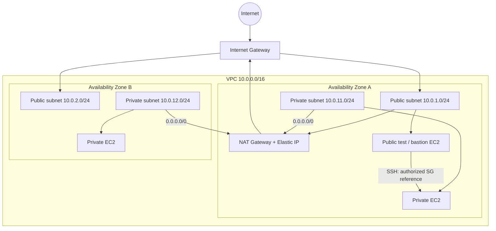

# Secure AWS VPC Architecture

**AWS Cloud Security Engineering | Network Segmentation | Secure Connectivity | Defense in Depth**

> **Project type:** Hands-on AWS Management Console project  
> **Focus:** Design, configure, and validate network isolation for workloads across two Availability Zones  
> **Status:** Add deployment evidence and test results after completing the console walkthrough

## Executive Summary

This project designs a segmented AWS network that separates internet-facing resources from private application workloads. It combines subnet-specific routing, stateful security groups, stateless network ACLs, and NAT-based egress. The design gives reviewers a clear view of the security decisions, implementation process, and the checks required to verify them.

## Architecture


**Logical network layout (conceptual):**



*The diagram shows a single-NAT laboratory configuration, not a zone-independent high-availability egress design. A NAT Gateway per AZ is a recommended production enhancement.*

### Network Plan

| Component | Value | Role |
|---|---|---|
| VPC | `10.0.0.0/16` | Isolated network boundary |
| Public subnet A | `10.0.1.0/24` | Internet-connected public tier |
| Public subnet B | `10.0.2.0/24` | Public tier in second AZ |
| Private subnet A | `10.0.11.0/24` | Private application workload |
| Private subnet B | `10.0.12.0/24` | Private workload in second AZ |
| Internet Gateway | Attached to VPC | Internet route for public subnets |
| Public NAT Gateway | Public subnet A | Outbound-only path for private IPv4 workloads |
| Public route table | `0.0.0.0/0 → IGW` | Public subnet routing |
| Private route table(s) | `0.0.0.0/0 → NAT` | Private subnet outbound routing |

## Security Objectives

- Prevent direct public addressing of private EC2 instances.
- Control administrative access to test instances from a trusted IP only.
- Permit only explicitly required traffic between workload tiers.
- Use subnet route tables to prevent private instances from routing directly to the Internet Gateway.
- Validate allowed and denied network paths, not merely inspect configurations.
- Explain where a single NAT Gateway creates a cross-AZ dependency.

## Services

Amazon VPC, Amazon EC2, Internet Gateway, public NAT Gateway, Elastic IP, route tables, security groups, and network ACLs. Optional later enhancements: Systems Manager Session Manager and VPC Flow Logs.

## Implementation — AWS Management Console

### 1. Create the VPC

1. Open **VPC → Your VPCs → Create VPC**.
2. Choose **VPC only**, name it `secure-vpc`, set IPv4 CIDR `10.0.0.0/16`, and create it.
3. Record the VPC ID and Region in your evidence notes.

### 2. Create four subnets

1. Open **VPC → Subnets → Create subnet** and select `secure-vpc`.
2. Create the subnets shown in the network plan, selecting two distinct Availability Zones in the same Region.
3. For private subnets, keep **Auto-assign public IPv4 address** disabled. On public test subnets, configure public IP assignment deliberately for the intended test workload.
4. Capture the subnet list with AZs and CIDRs.

### 3. Connect public subnets to the internet

1. Open **VPC → Internet gateways → Create internet gateway**; name it `secure-vpc-igw`.
2. Select it, choose **Actions → Attach to VPC**, and attach it to `secure-vpc`.
3. Open **Route tables → Create route table** and create `public-rt`.
4. Under **Routes → Edit routes**, add `0.0.0.0/0` targeting the Internet Gateway.
5. Under **Subnet associations**, associate both public subnets with `public-rt`.

### 4. Configure private subnet egress

1. Open **VPC → NAT gateways → Create NAT gateway**.
2. Select **Public** connectivity, choose public subnet A, and allocate or select an Elastic IP.
3. Wait until the NAT Gateway has **Available** status.
4. Create a private route table named `private-rt` with `0.0.0.0/0` pointing to the NAT Gateway.
5. Associate the two private subnets with `private-rt` for this laboratory. For an AZ-resilient design, use a separate NAT Gateway and private route table in each AZ.

### 5. Configure least-privilege Security Groups

Create these Security Groups in **EC2 → Security Groups**:

| Security Group | Inbound | Outbound | Notes |
|---|---|---|---|
| `public-admin-sg` | TCP 22 from **your trusted public IP/32** | Limited to the required test destinations where feasible | For controlled, temporary bastion testing only |
| `private-app-sg` | TCP 22 from `public-admin-sg` | Required outbound HTTPS (443) for tests | No inbound `0.0.0.0/0` rule |

**Security note:** For a production environment, prefer Session Manager over an internet-accessible SSH bastion. A Security Group reference authorizes traffic from network interfaces associated with that group; it does not confer IAM permissions.

### 6. Review Network ACLs

1. Go to **VPC → Network ACLs**, select the ACL associated with each subnet, and inspect inbound/outbound rules.
2. For this lab, document the default allow rules first; create a **custom NACL** only if you are deliberately testing subnet-level filtering.
3. If using a custom NACL, explicitly allow both requested traffic and **return traffic on ephemeral ports**, according to your clients and operating systems.
4. Record the rule order and test results. NACLs are **stateless**, unlike Security Groups.

### 7. Launch test instances

1. Open **EC2 → Launch instance** and create a short-lived public test instance in public subnet A with `public-admin-sg`.
2. Launch a private test instance in private subnet A with `private-app-sg`, ensuring **no public IPv4 address** is assigned.
3. Use a lab-approved SSH key, or Session Manager if properly configured. Do not upload private keys to GitHub.
4. Test permitted management access from the public instance to the private instance, if using the SSH lab pattern.
5. From the private instance, test an outbound HTTPS connection to an approved destination through the NAT Gateway.
6. Stop or delete test instances when no longer needed.

## Security Validation Matrix

| Test | Expected behavior | Evidence to capture |
|---|---|---|
| Private EC2 public IPv4 address | No public IPv4 assigned | EC2 networking details |
| Public subnet default route | Targets Internet Gateway | Public route table |
| Private subnet default route | Targets NAT Gateway | Private route table |
| SSH from untrusted internet address | Denied | SG rules and controlled negative test |
| SSH from authorized bastion | Allowed if configured | Test record and source SG reference |
| Private HTTPS egress | Allowed through NAT | Command output / session notes |
| NACL test (optional) | Matches explicit NACL rules | Rules and connection results |

**Results:** Add screenshots and a concise pass/fail log when you execute the environment. Do not interpret configuration screenshots as proof of connectivity by themselves.

## Security and Design Considerations

- **Stateful vs. stateless:** Security Groups track return traffic; NACLs require rules covering both directions.
- **Route isolation:** No public IP plus no IGW route in the private subnet reduces direct internet reachability; security groups still enforce allowed traffic.
- **NAT dependency:** One NAT Gateway in AZ A can disrupt private outbound access for both AZs if AZ A fails. Consider one NAT Gateway per AZ and AZ-local routing for production.
- **Cost management:** NAT Gateways, Elastic IPs, and EC2 instances can incur charges. Delete unused resources and review the Billing console after testing.
- **Improvement path:** Add VPC Flow Logs for observability, VPC endpoints for private AWS service connectivity, and Session Manager for administrative access.

## Troubleshooting Checklist

| Symptom | Review |
|---|---|
| Public instance has no internet | Public IP, subnet route to IGW, SG egress, NACL rules |
| Private instance has no outbound internet | Private route association, NAT status, NAT public subnet IGW route, SG/NACL rules |
| SSH to private instance fails | Source SG reference, host firewall, key/user, route reachability, NACL ephemeral return traffic |
| Cross-AZ egress is unavailable | Single NAT Gateway AZ dependence; check routing and AZ health |

## Evidence and Repository Organization

```
aws-secure-vpc-architecture/
├── README.md
├── architecture/
│   └── README.md
└── evidence/
    └── README.md
```

Suggested screenshots: VPC/subnets, public/private route tables, NAT Gateway state, Security Group rules, EC2 private IP details, and connectivity tests. Redact IPs and account-specific information if appropriate; never include credentials, private SSH keys, or secrets.

## Engineering Outcomes

This project provides a repeatable method to design segmented AWS networks and verify the security impact of subnet routing, NAT egress, and instance-level access controls. Its documentation is intended to show both **how the configuration is built** and **how it should be tested**.

## Official AWS Documentation

- [Create a VPC](https://docs.aws.amazon.com/vpc/latest/userguide/create-vpc.html)
- [VPC subnet fundamentals](https://docs.aws.amazon.com/vpc/latest/userguide/vpc-subnet-basics.html)
- [NAT Gateway basics and resilience](https://docs.aws.amazon.com/vpc/latest/userguide/nat-gateway-basics.html)
- [NAT devices](https://docs.aws.amazon.com/vpc/latest/userguide/vpc-nat.html)

---
*AWS Cloud Security Engineering Portfolio · Network Security Project 01*
